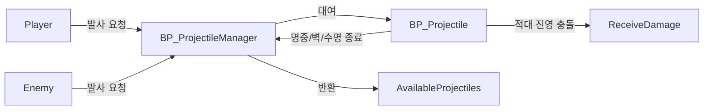

# 범용 투사체 풀링 시스템

기준 엔진: Unreal Engine 5.7.4, Blueprint-only

## 적용 상태

- `BP_ProjectileManager`의 `InitProjectilePool`과 `RequestProjectile`까지 사용자가 구현했다.
- `ReturnProjectile`, `BP_Projectile` 활성화·반환, 진영·피해 Interface, Player·Enemy 발사 연결, 컴파일과 PIE는 이후 작업이다.
- `BP_Projectile`은 사용자가 정한 `Content/Players/Projectile/BP_Projectile` 경로를 유지한다. 기능상 Player와 Enemy가 함께 쓰는 공용 Actor다.

## 전체 구조

`BP_Projectile`은 실제로 날아가고 충돌하는 Actor다. Player 전용 `BPC_ProjectileManager`가 아니라 Player와 Enemy가 함께 사용하는 월드 단위 `BP_ProjectileManager`를 사용한다.

```text
Content/Players/Projectile/BP_Projectile
Content/Managers/BP_ProjectileManager
Content/Data/E_CombatTeam
Content/Data/ST_ProjectileRequest
Content/Data/ST_DamageInfo
Content/Interfaces/BPI_CombatUnit
Content/Interfaces/BPI_Damageable
```



Manager는 발사자 종류를 알 필요가 없다. 발사자가 누가 쐈는지, 어느 진영인지, 어디서 쏘는지, 얼마나 피해를 주는지를 `ST_ProjectileRequest`로 전달한다.

## 1. 공용 데이터

### `E_CombatTeam`

Enum 값:

```text
Player
Enemy
Neutral
```

### `ST_ProjectileRequest`

Manager에 발사를 요청할 때 쓰는 구조체다.

| 변수 | 타입 | 설명 |
|---|---|---|
| `Shooter` | Actor Object Reference | 발사한 Actor |
| `Team` | E_CombatTeam | 발사자 진영 |
| `SpawnTransform` | Transform | 시작 위치와 발사 방향 |
| `Damage` | Float | 이번 투사체 피해 |
| `Speed` | Float | 이번 투사체 속도 |
| `LifeTime` | Float | 자동 회수 시간 |
| `ProjectileMesh` | Static Mesh Object Reference | 표시할 Mesh |
| `MeshScale` | Vector | 투사체 크기 |

Player는 화살 Mesh와 Player Team을 전달하고, Enemy는 자신만의 Mesh와 Enemy Team을 전달한다. 같은 `BP_Projectile`을 재사용해도 외형과 수치가 달라진다.

### `ST_DamageInfo`

피해를 받는 대상에게 전달하는 정보다.

| 변수 | 타입 |
|---|---|
| `Damage` | Float |
| `SourceActor` | Actor Object Reference |
| `SourceTeam` | E_CombatTeam |

## 2. Interface

### `BPI_CombatUnit`

함수:

```text
GetCombatTeam
→ Return: E_CombatTeam
```

- `BP_RunnerPlayer`는 `Player`를 반환한다.
- `BP_EnemyBase`는 `Enemy`를 반환한다.

### `BPI_Damageable`

함수:

```text
ReceiveDamage
→ Input: ST_DamageInfo
```

- Player와 Enemy 모두 구현한다.
- Player는 HP를 줄이고 체력바를 갱신한다.
- Enemy는 HP를 줄이고 0 이하이면 기존 사망·보상 처리를 실행한다.

이렇게 하면 Projectile은 `Cast To BP_RunnerPlayer`, `Cast To BP_EnemyBase`를 하지 않는다.

## 3. `BP_ProjectileManager`

`BP_ProjectileManager`는 Actor Blueprint로 만들고 맵에 한 개만 배치한다.

변수:

| 변수 | 타입 | 기본값 |
|---|---|---:|
| `ProjectileClass` | BP_Projectile Class Reference | BP_Projectile |
| `PoolSize` | Integer | 40 |
| `AvailableProjectiles` | BP_Projectile Object Reference Array | 빈 배열 |
| `ActiveProjectiles` | BP_Projectile Object Reference Array | 빈 배열 |
| `bPoolInitialized` | Boolean | false |

Player와 Enemy가 함께 사용하므로 PoolSize는 전체 동시 발사량을 기준으로 잡는다. 처음에는 `40`이면 충분하다.

### `InitProjectilePool`

`Event BeginPlay`에서 호출한다.

```text
Event BeginPlay
→ InitProjectilePool
```

함수 그래프:

```text
InitProjectilePool
→ bPoolInitialized
→ Branch
  True  → 종료
  False → For Loop
            First Index: 0
            Last Index: PoolSize - 1
```

For Loop 내부:

```text
Spawn Actor from Class
├ Class: ProjectileClass
├ Owner: Self
└ Collision Handling: Always Spawn, Ignore Collisions

→ InitializeProjectile
   PoolManager: Self

→ Add
   Target Array: AvailableProjectiles
```

마지막:

```text
Set bPoolInitialized = true
```

### `RequestProjectile`

입력: `Request : ST_ProjectileRequest`  
출력: `Projectile : BP_Projectile Object Reference`

```text
AvailableProjectiles Length
→ Greater than 0
→ Branch
```

False:

```text
Return None
```

True:

```text
Get AvailableProjectiles
└ Index: 0

→ Remove Index
   Target: AvailableProjectiles
   Index: 0

→ Add
   Target: ActiveProjectiles

→ ActivateProjectile
   Request: 입력 Request

→ Return Projectile
```

풀이 비어 있으면 발사를 생략한다. 여기서 추가 Spawn하지 않는다.

### `ReturnProjectile`

입력: `Projectile : BP_Projectile`

```text
Is Valid(Projectile)
→ Branch
  False → 종료
  True
    → ActiveProjectiles Contains(Projectile)
    → Branch
      False → 종료
      True
        → Remove Item(ActiveProjectiles)
        → Projectile.DeactivateProjectile
        → Add(AvailableProjectiles)
```

`Contains` 확인이 있어야 충돌과 수명 종료가 같은 프레임에 발생해도 투사체가 배열에 두 번 들어가지 않는다.

## 4. `BP_Projectile`

### 컴포넌트

```text
DefaultSceneRoot
└ SphereCollision       : Root Component
  └ ProjectileMesh      : Static Mesh Component

ProjectileMovement
```

`ProjectileMovement`의 Updated Component는 `SphereCollision`이다.

### Collision 설정

`SphereCollision`:

| 항목 | 값 |
|---|---|
| Collision Enabled | Query Only |
| Generate Overlap Events | 활성화 |
| World Static | Block |
| Pawn | Overlap |
| World Dynamic | Overlap |
| 나머지 | Ignore |

Enemy가 별도 `Enemy` Object Channel을 사용한다면 해당 Channel도 `Overlap`으로 설정한다.

`ProjectileMesh`는 `No Collision`이다.

### `ProjectileMovement` 설정

| 항목 | 값 |
|---|---:|
| Initial Speed | 3000 |
| Max Speed | 3000 |
| Projectile Gravity Scale | 0 |
| Rotation Follows Velocity | 활성화 |
| Initial Velocity in Local Space | 활성화 |

Mesh가 화살 방향과 다르게 보이면 이동 방향을 바꾸지 말고 `ProjectileMesh`의 Relative Rotation만 조정한다.

### 변수

| 변수 | 타입 |
|---|---|
| `PoolManager` | BP_ProjectileManager Object Reference |
| `CurrentRequest` | ST_ProjectileRequest |
| `bIsActive` | Boolean |
| `LifeTimerHandle` | Timer Handle |

`Initial Life Span`은 `0`으로 둔다. 수명 종료도 Destroy가 아니라 풀 반환이다.

### `InitializeProjectile`

입력: `InPoolManager`

```text
Set PoolManager = InPoolManager
→ DeactivateProjectile
```

### `ActivateProjectile`

입력: `Request : ST_ProjectileRequest`

```text
Clear and Invalidate Timer by Handle(LifeTimerHandle)
→ Set CurrentRequest = Request
→ Set bIsActive = true
→ Set Actor Transform(Request.SpawnTransform)
→ ProjectileMesh Set Static Mesh(Request.ProjectileMesh)
→ ProjectileMesh Set Relative Scale 3D(Request.MeshScale)
→ SphereCollision Set Collision Enabled(Query Only)
→ Set Actor Hidden In Game(false)
→ ProjectileMovement Set Initial Speed(Request.Speed)
→ ProjectileMovement Set Max Speed(Request.Speed)
→ ProjectileMovement Activate
→ Set Velocity in Local Space
  X: Request.Speed
→ Set Timer by Event
  Event: RequestReturn
  Time: Request.LifeTime
  Looping: false
```

### `DeactivateProjectile`

```text
Set bIsActive = false
→ Clear and Invalidate Timer by Handle(LifeTimerHandle)
→ ProjectileMovement Stop Movement Immediately
→ ProjectileMovement Deactivate
→ SphereCollision Set Collision Enabled(No Collision)
→ Set Actor Hidden In Game(true)
```

### `RequestReturn`

```text
bIsActive
→ Branch
  True  → PoolManager.ReturnProjectile(Self)
  False → 종료
```

## 5. Projectile 충돌

`SphereCollision`의 `On Component Begin Overlap`:

```text
OnComponentBeginOverlap
→ bIsActive
→ Branch
  False → 종료
  True
    → Other Actor == CurrentRequest.Shooter
    → Branch
      True  → 종료
      False
        → Does Implement Interface
          Interface: BPI_CombatUnit
          Test Object: Other Actor
        → Branch
          False → 종료
          True
            → GetCombatTeam (Message)
              Target: Other Actor
            → OtherTeam != CurrentRequest.Team
            → Branch
              False → 종료
              True
                → Make ST_DamageInfo
                  Damage: CurrentRequest.Damage
                  SourceActor: CurrentRequest.Shooter
                  SourceTeam: CurrentRequest.Team
                → Does Implement Interface
                  Interface: BPI_Damageable
                  Test Object: Other Actor
                → Branch
                  True
                    → ReceiveDamage (Message)
                      Target: Other Actor
                      DamageInfo: 만든 구조체
                    → RequestReturn
```

동작 결과:

- Player 투사체는 Enemy만 피해를 준다.
- Enemy 투사체는 Player만 피해를 준다.
- 같은 진영의 다른 Enemy와 자기 자신은 통과한다.
- `Neutral`은 필요할 때 별도 규칙을 추가한다.

벽 충돌용으로 `SphereCollision`의 `On Component Hit`도 추가한다.

```text
OnComponentHit
→ bIsActive
→ Branch
  True → RequestReturn
```

## 6. Player 발사 요청

`BP_RunnerPlayer`에는 `ProjectileSpawnPoint` Scene Component를 추가한다.

```text
FireProjectile
→ Get World Transform(ProjectileSpawnPoint)
→ CurrentStats.StatusValue Map Find
  Key: 공격력 E_Stats 값
→ Make ST_ProjectileRequest
  Shooter: Self
  Team: Player
  SpawnTransform: SpawnPoint Transform
  Damage: 찾은 공격력
  Speed: 화살 속도 스탯 또는 기본값
  LifeTime: 3.0
  ProjectileMesh: 화살 Mesh
  MeshScale: (1, 1, 1)
→ ProjectileManager.RequestProjectile
```

`ProjectileManager`는 Player BeginPlay에서 `Get Actor Of Class(BP_ProjectileManager)`를 한 번만 호출해 캐시한다.

## 7. Enemy 발사 요청

Enemy도 같은 Manager를 사용한다. Request 값만 다르다.

```text
EnemyFireProjectile
→ Get Player Character
→ Find Look At Rotation
  Start: EnemyAttackSpawnPoint Location
  Target: Player Location
→ Make Transform
  Location: EnemyAttackSpawnPoint Location
  Rotation: Look At Rotation
→ Make ST_ProjectileRequest
  Shooter: Self
  Team: Enemy
  SpawnTransform: 만든 Transform
  Damage: Enemy 공격력
  Speed: Enemy 투사체 속도
  LifeTime: 3.0
  ProjectileMesh: Enemy 전용 Mesh
  MeshScale: Enemy용 크기
→ ProjectileManager.RequestProjectile
```

Manager와 Projectile은 Player/Enemy를 구분하지 않으며, 발사자만 Request를 다르게 만들어 전달한다.

## 8. 구현 순서

1. `E_CombatTeam`, `ST_ProjectileRequest`, `ST_DamageInfo` 생성
2. `BPI_CombatUnit`, `BPI_Damageable` 생성
3. Player와 Enemy에 두 Interface 구현
4. `BP_Projectile` 구현
5. `BP_ProjectileManager`의 Pool 함수 구현
6. 레벨에 Manager 한 개 배치
7. Player 자동 발사 연결
8. Enemy 발사 연결
9. 컴파일 후 PIE 검증

## 9. 검증

PIE에서 다음을 확인한다.

- 발사 시 `AvailableProjectiles`가 하나 줄고 `ActiveProjectiles`가 하나 늘어난다.
- Enemy 명중 시 HP가 한 번만 감소하고 투사체가 즉시 숨겨진다.
- 수명 동안 아무것도 맞히지 않은 투사체가 자동 반환된다.
- 풀을 모두 사용했을 때 새 Actor가 Spawn되지 않고 발사만 생략된다.
- 반환 후 같은 투사체가 정상 재사용된다.
- Player 투사체는 Enemy만, Enemy 투사체는 Player만 피해를 준다.

이 구조에서는 이후 화살, 불덩이, 독 투사체를 추가해도 `BP_Projectile`과 Manager를 복제하지 않고 Request에 전달하는 Mesh·속도·피해만 바꾸면 된다.
